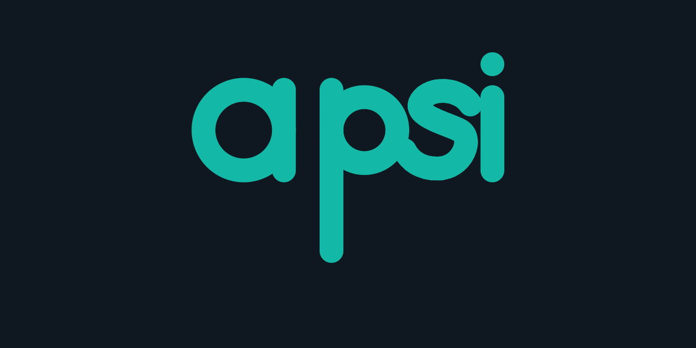

<p align="center"></p>

# Apsi 1.10.0 (`.apsi`)

**Apsi** is a programming language for **AI**, **physics** and **servers**. Physical units, tensor-shape
checking, automatic differentiation, number formats from FP64 down to FP4, data pipelines and a hardened
HTTP server are built into the language. It reads like Python, but catches mistakes before the program runs.

```apsi
use physics.constants

fn kinetic(m: Mass, v: Velocity) -> Energy = 0.5 * m * v ** 2

print(kinetic(2kg, 3[m/s]))          # 9.0 J
print(m_e * c ** 2 as [MeV])         # 0.510998949996 MeV

let wrong = 5m + 2s                  # ✗ UnitError before running: cannot add Length and Time
```

## Install

| System | File in `dist/` |
|---|---|
| Windows 10/11 (x64) | `ApsiSetup-1.10.0-x64.exe` — setup wizard with its own Python; no administrator rights needed |
| Any Linux (also WSL) | `sh ApsiSetup-1.10.0-linux.sh` — one-file installer, no root; commands, `.apsi` file type with icon, editor support |
| Ubuntu / Debian | `sudo apt install ./apsi_1.10.0_all.deb` |
| Any system with Python 3.9+ | `pip install apsi-1.10.0-py3-none-any.whl` |
| Code editors | the setup wizard adds Apsi to VS Code, Cursor, Windsurf, VSCodium, Sublime Text, Vim/Neovim and Notepad++ it finds (`apsi editors install` does the same later) |

The installer adds `apsi` to your PATH (open a **new** terminal afterwards — already-open terminals and VS Code must
be restarted to see it; see *Troubleshooting* in [`docs/INSTALL.md`](docs/INSTALL.md#troubleshooting)), registers `.apsi` files (icon, *Run with Apsi*, *Edit*, and
*New → Apsi source file* in Explorer), creates Start-menu / application-menu entries and adds Apsi to your code editors. Details: [`docs/INSTALL.md`](docs/INSTALL.md) · [`docs/INSTALL-LINUX.md`](docs/INSTALL-LINUX.md)

Without installing: `pip install numpy`, then use `apsi.bat …` (Windows) or `./apsi.sh …` (Linux) from this folder.

### Build from source

| | Command |
|---|---|
| Windows: development setup + tests | `powershell -ExecutionPolicy Bypass -File setup.ps1` |
| Windows: + setup wizard | `powershell -ExecutionPolicy Bypass -File setup.ps1 -Installer` |
| Linux: development setup + tests | `./setup.sh` |
| Linux: + AppImage wizard / all release files | `./setup.sh --installer` / `./setup.sh --release` |
| Optional libraries | add `-Libs ai` (Windows) or `--libs ai` (Linux): `gpu`, `onnx`, `torch-auto` (the right PyTorch build), `torch`, `torch-cuda`, `transformers`, `sci`, `data`, `ai`, `ai-gpu`, `science`, `all` |

Full details: [`docs/BUILD.md`](docs/BUILD.md)

## Your first program

```bash
apsi new hello          # create a project (templates: app, lib, physics, ai, server)
cd hello
apsi run                # runs src/main.apsi
apsi test               # runs the tests in tests/
apsi                    # interactive REPL
```

## Highlights

| Area | What Apsi gives you |
|---|---|
| **Physical units** | `9.81[m/s^2]`, `2kg`, `5[km]` are checked before the program runs; convert with `as [km]`; every SI unit and prefix plus CODATA constants |
| **Tensor shapes** | `fn f[B, T, D](x: Tensor[B, T, D])` — a mismatch names the exact dimension that is wrong |
| **Autodiff** | `grad(f)`, `value_and_grad(f)` on tensors, structs and records, unit-aware (`grad(energy)` has the unit of a force); any order: `hessian`, `jacobian`, `laplace`, `grad(grad(f))` — enough for physics-informed neural networks |
| **AI** | `use layers`: **any architecture as a graph of layers** (`sequential`, `residual`, `parallel`, `dag`), transformers, CNNs, LSTM/GRU, autoencoders/VAEs, **graph neural networks** (GCN, GraphSAGE, GAT, GIN), a model zoo and `fit()`; plus Adam/AdamW/SGD, schedules, gradient clipping, save/load — reference: [`docs/LAYERS.md`](docs/LAYERS.md) |
| **GPU training (PyTorch)** | the same models train on PyTorch with `fit(…, backend="torch")` — NVIDIA CUDA, AMD ROCm, Apple MPS, Intel XPU or CPU; fp64/fp32/tf32, bf16/fp16 mixed precision, `torch.compile`, fused attention, cuDNN LSTMs; `torch_module()` gives a real `torch.nn.Module`; `check_torch()` verifies every layer against NumPy; `apsi pkg install torch-auto` picks the right CUDA build — [`docs/BACKENDS.md`](docs/BACKENDS.md) |
| **From Python** | `apsi convert` translates Python files and folders — numpy, math, random, json, PyTorch tensors and `torch.nn` layers map onto Apsi; any other library keeps working through `pyimport` |
| **Physics** | `sci.solve_ivp` with an implicit TR-BDF2 solver for **stiff** systems and adaptive RK45; `evolve` solves differential equations with euler / midpoint / rk4 / adaptive **rk45** / symplectic / verlet; Laplacians for PDEs; linalg (eigh, solve, …); measurement uncertainty `9.81 ± 0.02` that propagates through formulas with correct correlations |
| **Speed** | the compiler turns the whole program into bytecode; every function has an "erased twin" without unit bookkeeping for hot loops; parsed programs are kept in a signed compile cache; tensor work runs on multi-threaded BLAS, on the GPU through CuPy, and neural networks through PyTorch |
| **Executables** | `apsi build app.apsi` → `app.exe` (Windows) / `app` (Linux) with the program, its imports, Apsi as bytecode and fixed permissions; `--standalone` adds its own Python runtime for PCs without Apsi |
| **Precision** | `@precision(exact)` computes with exact fractions; `@precision(f32)` / `f16` for AI |
| **Security** | permission system (Python, C, network are off by default), Apsi Guard pre-run scan, and a `crypto` module (scrypt, HMAC, SHA-3, tokens, constant-time compare) |
| **Other languages** | Python/PyTorch (`pyimport`, `to_torch`, `torch_module`), C/C++ (`cload`, zero-copy tensors), JS/Next.js/Java through `apsi serve` (JSON HTTP API) |
| **Number formats** | FP64, FP32, FP16, BF16, FP8 (E4M3/E5M2), FP6, FP4, INT8, INT4 — bit-exact with current GPU formats, stored at their real size, quantization-aware training |
| **Data** | streaming pipelines: parallel map, prefetch, shuffle, vectorized batching (~2 M rows/s), sliding windows, sharding, interleaving; CSV, JSON Lines, Parquet, `.npy`; memory-mapped tensors on SSD, signed on-disk cache |
| **Accuracy** | exact fractions, correctly rounded sums (`fsum`), measurement uncertainty, unit checking, bit-exact low-precision formats |
| **Concurrency** | tasks, channels, locks, atomics, `parallel_for` / `parallel_reduce`, `pmap`, BLAS thread control |
| **Servers** | `use web`: asyncio + worker pool + multi-process, 7,700 req/s at 500 concurrent connections (2 vCPU); protection against slowloris, request smuggling, path traversal, header injection and DoS; JWT, API keys, rate limits, CORS, TLS, metrics |
| **AI models** | `use models`: safetensors read/write, memory-mapped loading, INT8/FP8/FP4 compression (4–16× less RAM), `qlinear`; ONNX Runtime, Hugging Face and PyTorch models served as an API in a few lines |
| **Tooling** | `run`, `check`, `test`, `fmt`, `watch`, `bench`, `build`, `compile`, `convert`, `new`, `task`, `doc`, `lsp`, `repl`, `serve`, `doctor`, `editors`, `pkg`; extensions for VS Code, Cursor, Windsurf, VSCodium, Sublime Text, Vim/Neovim and Notepad++ with live diagnostics, unit hovers, go to definition, tasks, snippets and themes; web playground (WebAssembly) |
| **Platforms** | Windows 10/11 and Linux installers; CI on Windows Server 2022/2025 and Ubuntu 22.04/24.04; Python 3.9–3.14 |

## Commands

```text
apsi                          interactive REPL (cd, ls, run FILE, !cmd and :help work inside it)
apsi FILE.apsi [ARGS]         run a program (same as apsi run)
apsi -e "CODE"                evaluate code and print the result
apsi run [FILE] [ARGS]        check, then run (default: the project's main file); --watch, --time
apsi check [PATHS]            check files or folders without running them
apsi test [PATHS]             run every test "..." block
apsi fmt [PATHS]              format code (--check for CI)
apsi watch [PATHS]            re-run, re-test or re-check on every save
apsi bench FILE               time a program over several runs
apsi build FILE               make an executable: app.exe (Windows) / app (Linux); --standalone, --allow-…
apsi compile [PATHS]          compile programs ahead of time into the signed compile cache (--stats, --clear)
apsi new NAME / apsi init     create a project with apsi.toml, src/, tests/ and VS Code tasks
apsi task [NAME] / apsi NAME  run a task from apsi.toml
apsi doc [NAME]               documentation for built-ins and modules
apsi audit / scan / verify    permissions a program needs / malware scan / installation integrity
apsi serve FILE               expose a program's functions as a JSON HTTP API
apsi pkg install torch-auto   optional Python libraries (torch-auto, gpu, onnx, transformers, ai, …)
apsi config --profile strict  default security profile
apsi completion powershell    shell completion (bash, zsh, fish, powershell)
apsi editors install          Apsi support in VS Code, Cursor, Windsurf, VSCodium, Sublime, Vim/Neovim, Notepad++
apsi convert app.py           translate Python (and whole folders) into Apsi
apsi lsp | doctor | ast | tokens | version
```

Every command and flag is described in the *Command line* chapter of [`docs/LANGUAGE.md`](docs/LANGUAGE.md).

## Examples (`examples/`)

| File | Shows |
|---|---|
| `01_hello` | language basics: let/var, functions, structs, comprehensions, pipes |
| `02_units` | physical units, conversions, constants |
| `03_autodiff` | derivatives, force from potential energy, linear regression |
| `04_projectile` | projectile with air drag (rk4) |
| `05_orbit` | one year of Earth's orbit; energy drift only 1e-14 (verlet) |
| `06_heat_equation` | 2-D heat equation |
| `07_quantum_box` | Schrödinger equation; energy levels match theory |
| `08_neural_net` | MLP trained from scratch to 99 % accuracy |
| `09_transformer` | character-level mini-GPT written from scratch |
| `10_cnn` | convolutional network |
| `11_precision` | exact / f32 / memo |
| `12_security` | passwords, HMAC, hashing, sandbox |
| `13_interop` | Python / PyTorch / C |
| `14_api_server` | HTTP API for Next.js / Java |
| `15_native_c` | calling your own compiled C without copying data |
| `16_nbody` | vectorized gravity for 200 bodies |
| `17_wave` | wave on a string returns to its shape after one period |
| `18_pinn` | physics-informed network learns cos(ωt) from the equation alone |
| `19_measurement` | measurement uncertainty + rk45 |
| `20_spectrum` | FFT finds a signal's frequency (in Hz) |
| `21_curve_fit` | fit a decay to get τ ± σ; minimize, root finding, integration |
| `22_lstm_sequence` | LSTM time-series prediction |
| `23_web_api` | API server: AI model, orbit simulation, JWT login, rate limit |
| `24_low_precision` | FP64 → FP4/INT4 comparison + quantization-aware training |
| `25_data_pipeline` | parallel SSD data pipeline + prefetch + disk_cache |
| `26_model_serving` | train → safetensors → INT8 load → API |
| `27_pretrained_models` | Hugging Face / ONNX → API |
| `28_any_architecture` | `use layers`: residual MLP, a home-made DAG, a graph attention network, a small GPT |
| `29_stiff_chemistry` | stiff Robertson kinetics and an RC circuit with `sci.solve_ivp` |

## Tests

```bash
apsi test examples tests/apsi --allow-all   # test blocks written in Apsi (pass on --engine compile and interp)
python -m unittest discover tests           # toolchain, REPL, CLI, LSP, formatter, Windows/Linux, web server
```

## Development

Development started on **Sunday, 8 November 2026 at about 04:00** (Bangkok time, UTC+7); this release was completed the same morning at about **09:00** — about **5 hours** of development.

## Documentation

- [`docs/LANGUAGE.md`](docs/LANGUAGE.md) — **the complete language reference**: syntax, types, units, functions, structs, modules, every built-in, the REPL and the command line
- [`docs/AI.md`](docs/AI.md) — building AI with Apsi: any architecture, smaller RAM/VRAM, pretrained models, serving
- [`docs/LAYERS.md`](docs/LAYERS.md) — **`use layers` reference**: every layer with shapes and parameters, `dag`, graph neural networks, the model zoo, `fit`, recipes
- [`docs/BACKENDS.md`](docs/BACKENDS.md) — NumPy and PyTorch backends: CUDA, ROCm, Apple MPS, Intel XPU, bf16/fp16 mixed precision, `torch.compile`, `torch.nn.Module` export
- [`docs/PYTHON.md`](docs/PYTHON.md) — converting Python programs with `apsi convert`
- [`docs/SERVER.md`](docs/SERVER.md) — secure, high-throughput servers
- [`docs/PERFORMANCE.md`](docs/PERFORMANCE.md) — number formats, CPU, GPU, PyTorch, RAM, SSD
- [`docs/INTEROP.md`](docs/INTEROP.md) — Python, PyTorch, C/C++, JS/Next.js, Java
- [`docs/SECURITY.md`](docs/SECURITY.md) — permissions, Apsi Guard, profiles
- [`docs/EDITORS.md`](docs/EDITORS.md) — VS Code, Cursor, Windsurf, VSCodium, Sublime Text, Neovim/Vim, Notepad++, JetBrains, Helix, Zed, Emacs
- [`docs/INSTALL.md`](docs/INSTALL.md) · [`docs/INSTALL-LINUX.md`](docs/INSTALL-LINUX.md) · [`docs/BUILD.md`](docs/BUILD.md)
- [`docs/PLAYGROUND.md`](docs/PLAYGROUND.md) — the web playground
- [`docs/ROADMAP.md`](docs/ROADMAP.md) · [`CHANGELOG.md`](CHANGELOG.md)

## Source layout

```
apsi/            the language
  lexer.py       text → tokens (indentation, Unicode, unit literals)
  parser.py      tokens → syntax tree
  checker.py     names, units, argument counts and evolve rules, checked before running
  interpreter.py reference tree-walking runtime
  codegen.py     Apsi → Python bytecode compiler (default engine) + erased twins
  compiler.py    closure compiler for evolve in the interpreter engine
  cli.py         the apsi command
  repl.py        the interactive REPL
  project.py     apsi new / init / task and apsi.toml
  editors.py     apsi editors: integrations for VS Code-family editors, Sublime, Vim/Neovim, Notepad++
  convert.py     apsi convert: Python → Apsi translator with library mapping
  layers.py      use layers: composable layers, DAG models, GNNs, model zoo, fit
  runner.py      runs programs on a large stack (deep recursion), forwards Ctrl+C
  tools.py       apsi eval / watch / bench / doc / completion
  integrators.py rk45 (Dormand–Prince)
  uncertain.py   measurement uncertainty and error propagation
  sci.py         einsum, FFT, integrate, find_root, minimize, curve_fit
  formatter.py   apsi fmt
  lsp.py         language server
  playground.py  runner for the web playground
  precision.py   BF16/FP8/FP6/FP4/INT8/INT4
  data.py        data pipelines and SSD storage
  concurrency.py tasks, channels, parallel loops
  web.py         HTTP server
  models.py      safetensors, model compression, ONNX / Hugging Face / PyTorch
  units.py       SI dimensions and the Quantity type
  autodiff.py    reverse-mode autodiff (incl. conv2d and attention ops)
  ops.py         math/tensor operations for numbers, tensors, quantities and autodiff nodes
  stdlib.py      built-ins and the nn / physics / linalg / random modules
  interop.py     Python, PyTorch, C FFI, files, network (through the permission system)
  crypto.py      security module
  security.py    permissions, profiles, release manifest
  guard.py       Apsi Guard pre-run threat scan
  hardware.py    apsi doctor and the GPU backend
  server.py      apsi serve
examples/        29 examples (+ native/: C code and build scripts for Windows/Linux)
tests/           test suite
docs/            documentation
editors/         editor integrations: vscode/ (VS Code, Cursor, Windsurf, VSCodium), sublime/, vim/ (Vim + Neovim),
                 notepad++/, textmate/ (JetBrains, TextMate), helix/, zed/, emacs/
install/         script installers for Windows (install.ps1 / install.bat) and Linux (install.sh)
installer/       the setup wizard (Electron + React)
playground/      browser playground
packaging/       release builds (.exe, .deb, zip, wheel)
tools/           playground build and test scripts
.github/         CI on Windows and Linux
```

Test the playground in real WebAssembly:

```bash
npm install pyodide@0.27.7 && node tools/test_playground.mjs playground/apsi_bundle.js
```
