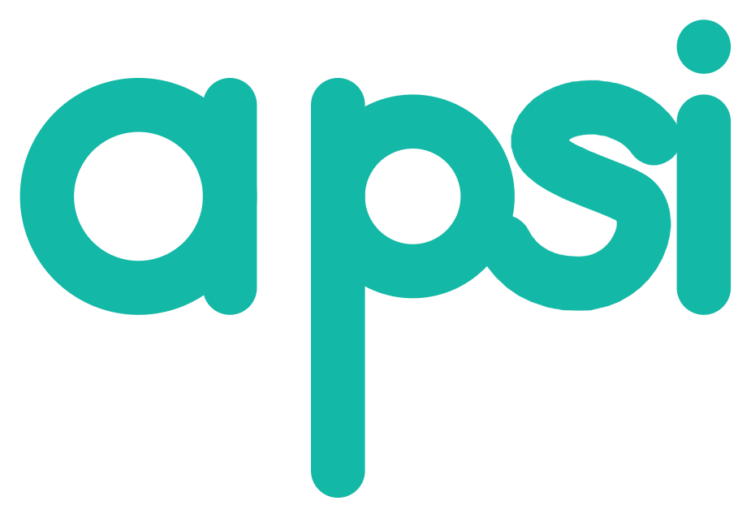

<p align="center"></p>

<p align="center"><strong>A programming language for AI, physics and servers — that reads like Python and checks your work before it runs.</strong></p>

<p align="center">
  <a href="https://github.com/ATECTechnologies/apsi/actions/workflows/linux-x64.yml"></a>
  <a href="https://github.com/ATECTechnologies/apsi/actions/workflows/darwin-x64.yml"></a>
  <a href="https://github.com/ATECTechnologies/apsi/actions/workflows/windows-x64.yml"></a>
</p>
<p align="center">
  <a href="https://github.com/ATECTechnologies/apsi/actions/workflows/linux-arm64.yml"></a>
  <a href="https://github.com/ATECTechnologies/apsi/actions/workflows/darwin-arm64.yml"></a>
</p>
<p align="center">
  <a href="https://apsi.dev/download"></a>
  
  
  
  <a href="LICENSE"></a>
</p>

<p align="center">
  <a href="https://apsi.dev">Website</a> ·
  <a href="https://apsi.dev/docs">Documentation</a> ·
  <a href="docs/WHATS-NEW.md">What's new in 2.6.2</a> ·
  <a href="https://apsi.dev/benchmarks">Benchmarks</a> ·
  <a href="https://apsi.dev/download">Download</a>
</p>

---

## What is Apsi?

Apsi is a programming language with the syntax of Python and the safety net of a compiler. Physical units, tensor
shapes and types are checked before the program starts, so `5m + 2s` or a matrix of the wrong size is an error on the
line where you wrote it, not a wrong number an hour later. Numeric code compiles to machine code, and every Python
library is one `pyimport` away.

```apsi
use physics.constants

fn kinetic(m: Mass, v: Velocity) -> Energy = 0.5 * m * v ** 2

print(kinetic(2kg, 3[m/s]))            # 9.0 J
print(m_e * c ** 2 as [MeV])           # 0.510998949996 MeV
let wrong = 5m + 2s                    # ✗ UnitError before running: cannot add Length and Time

@native                                # machine code for this CPU, units checked then erased
fn energy(x, v, k: Float) -> Float:
    var e = 0.0
    parallel for i in 0..len(x):       # all CPU cores; @gpu runs the same loop on NVIDIA GPUs
        e += 0.5 * v[i] * v[i] + 0.5 * k * x[i] * x[i]
    return e
```

## How Apsi is different

| | Python | Apsi |
|---|---|---|
| Units (`9.81[m/s^2]`, `5km`) | a library, checked at run time | part of the language, checked before running |
| Tensor shapes | found when the program crashes | `fn f[B, T](x: Tensor[B, T])` names the wrong dimension before running |
| Speed of numeric loops | interpreter | `@native`: LLVM machine code, next to C and Rust on the [benchmarks](https://apsi.dev/benchmarks) |
| Existing Python code | — | `apsi convert` turns it, and the libraries written in Python it uses, into Apsi that behaves byte for byte the same |
| Permissions | a script can read any file and open any socket | files, network and Python modules are off until you allow them |
| Built in | — | autodiff, layers, RL, real-time loops, tables, PostgreSQL / MySQL / MongoDB / Redis, an HTTP and WebSocket server |

## Install

**Download: [apsi.dev/download](https://apsi.dev/download)** — every version, with the SHA-256 of each file.

| System | File | Install |
|---|---|---|
| Windows 10/11 (x64) | `ApsiSetup-2.6.2-x64.exe` | double-click (brings its own Python; no administrator rights) |
| Any Linux, also WSL | `ApsiSetup-2.6.2-linux.sh` | `sh ApsiSetup-2.6.2-linux.sh` (no root) |
| Ubuntu / Debian | `apsi_2.6.2_all.deb` | `sudo apt install ./apsi_2.6.2_all.deb` |

From this repository: `pip install numpy`, then `./apsi.sh run examples/01_hello.apsi` (Linux, macOS) or
`apsi.bat run examples\01_hello.apsi` (Windows). Building the installers: [`docs/BUILD.md`](docs/BUILD.md).

## Quick start

```bash
apsi new hello && cd hello
apsi run                        # runs src/main.apsi
apsi test                       # runs the tests next to it
apsi convert script.py          # an existing Python program → script.apsi, same behaviour
apsi debug app.apsi             # breakpoints and stepping (or F5 in VS Code)
```

Then read [Getting started](docs/GETTING-STARTED.md) (15 minutes) or [Write Apsi your way](docs/WRITE-APSI.md).

## Train your own language model

A tokenizer, a LLaMA / Qwen3-style decoder, training and text written by the model — the whole program
([`examples/47_train_your_llm.apsi`](examples/47_train_your_llm.apsi)), seconds on a laptop:

```apsi
use layers
use data
use nn

let corpus = ["The planet orbits the star once a year. " * 4, "Energy is mass times the speed of light squared. " * 4]
let tok = data.train_tokenizer(corpus, vocab_size=300)                    # byte-level BPE, as GPT-2 / Llama 3 / Qwen
let batches = [b for b in (data.text_dataset(corpus, tokenizer=tok, seq_len=24) |> batch(8))]

let lm = transformer_lm(tok.vocab_size, d=64, heads=4, layers=2, context=24,
                        kv_heads=2, rope=true, qk_norm=true, norm="rms", ffn="swiglu")
let r = fit_batches(lm, lm.init(seed=0), batches, loss="cross_entropy",
                    opt=adamw(lr=3e-3, state="bf16"), epochs=40, clip=1.0)
print(f"loss {r.history[0]:.2f} -> {r.history[-1]:.2f}")                 # loss 6.74 -> 0.02
```

The same lines train a 127 M model on an NVIDIA card (`backend="gpu"`, `steps=`, `checkpoint=` to resume exactly
after any stop): 16,000–18,000 tokens/s on an RTX 3060, the [measured numbers](https://apsi.dev/benchmarks).

## What's new in 2.6.2

* **Large models on one card.** Activation recompute measured per block (planned again when a batch grows), global
  attention in pieces, nothing per edge kept, optimizer moments in bfloat16.
* **Your own GPU kernels as layers** (`gpu_layer`), **parameter groups** (each part its own AdamW settings and
  clipping), **weighted cross-entropy on the card** (`card_loss(weights=)`).
* **Other programs' model files:** a parameter tree under another program's tensor names (`models.named_tensors` /
  `from_named_tensors`), text metadata in `.safetensors`, running statistics of layers in checkpoints.
* **Training that resumes exactly and learns from its own output:** batches made when training reaches them
  (`record(later=fn)`, `training_params()`), your program's state and the random generators in the checkpoint
  (`state=`), steps of their own length, parts with their own optimizer step every batch.
* **Half the optimizer's memory:** `adamw(state="bf16")` (bfloat16 moments, stochastic rounding).
* **The language:** raw strings `r#"..."#`, Python kept inside a program (`pymodule`).

## What's new in 2.6.0

* **Faster than PyTorch on the same card.** A 127 M GPT, 2 epochs on an RTX 3060: 20,708 tokens/s against PyTorch 2.14
  bf16's 18,809 at the same temperature (1.10×), on Apsi's own 16-bit kernels (no cuBLAS), the card never above 79 °C.
* **The same weights on one card or eight.** Gradients of accumulated batches, of copies of the model and across the
  cuts of a model split over cards are summed exactly (double-float, rounded once): adding cards makes training
  faster, never different.
* **The same weights every run.** No atomic additions anywhere in training — bias and norm gradients, embeddings,
  losses, split products, attention's backward all add in a fixed order. Checked on a real RTX 3060: heterogeneous graph models and a
  transformer trained twice give identical weights.
* **Training that finishes.** `fit_batches(…, steps=20000, checkpoint="run.npz", save_every=500)`: saved on any stop
  (a crash, Ctrl+C), resumed bit for bit by running the same line again; a step with an inf or NaN gradient is skipped
  inside the optimizer kernel. [Training guide](docs/TRAINING.md).
* **Heterogeneous graphs.** `hgt`, `typed_linear`, `typed_norm`: graphs with many node types and relations, on
  NumPy, one card or many. [Graphs](docs/GRAPHS.md).
* **Fewer tokens.** `tokens.focus(context, question, budget)` keeps what a question needs, chosen on
  code and text graphs, and numbers what it leaves out so anything can be put back exactly (`unfold`);
  `fit_chat` for conversations. A 15,137-token module to 1,333 tokens for one question. [Tokens](docs/TOKENS.md).
* **Your own tokenizer.** `data.train_tokenizer(corpus, vocab_size=32000)`: byte-level BPE in Apsi (or Rust when
  installed), saved as tokenizer.json.
* **Any optimizer, loss and layer on the GPU trainer**, frozen parts for fine-tuning, `gpu_tensor` for your own code
  on the card, physics-informed networks (`pinn_fit`), one model across many cards.
* **The card never waits:** queued copies through pinned memory, losses and gates kept on the card, one launch per
  reduction — a small transformer's step from 5.3–6.0 ms to 4.0–4.7 ms on an RTX 3060 (best runs).
* **Every setting in one file:** [`config/apsi-training.env`](config/apsi-training.env), each with its default and
  what it does.

Details, examples and measurements: [`docs/WHATS-NEW.md`](docs/WHATS-NEW.md) · every change: [`CHANGELOG.md`](CHANGELOG.md) ·
2.4.4: [`docs/WHATS-NEW-2.4.4.md`](docs/WHATS-NEW-2.4.4.md).

## Supported platforms

| | |
|---|---|
| Operating systems | Windows 10 / 11 (x64), Linux x86-64 and ARM64 (Ubuntu 22.04+, Debian 12+, Fedora, Arch, WSL), macOS on Apple silicon and Intel — each tested on every push |
| Python (host runtime) | 3.12, 3.13, 3.14 |
| Native compiler | x86-64 with AVX2 / AVX-512, ARM64 with NEON (needs `llvmlite`; on Intel Macs, where llvmlite has no wheels, Apsi runs without it) |
| GPUs | NVIDIA GTX 1660 and newer (training on Apsi's own tensor-core kernels; only the NVIDIA driver needed); AMD ROCm, Apple MPS, Intel XPU through the PyTorch backend |
| Editors | VS Code, Cursor, Windsurf, VSCodium, Sublime Text, Vim/Neovim, Notepad++, JetBrains, Helix, Zed, Emacs |

## Documentation

| Start | Language | Topics |
|---|---|---|
| [Getting started](docs/GETTING-STARTED.md) | [Language reference](docs/LANGUAGE.md) | [AI](docs/AI.md) · [Layers](docs/LAYERS.md) · [Training](docs/TRAINING.md) · [GPU](docs/GPU.md) · [RL](docs/RL.md) |
| [What's new](docs/WHATS-NEW.md) | [Everything on one page](docs/REFERENCE.md) | [From Python](docs/PYTHON.md) · [Native code](docs/NATIVE.md) · [Embedded](docs/EMBEDDED.md) |
| [Install](docs/INSTALL.md) · [Linux](docs/INSTALL-LINUX.md) | [Project overview](docs/OVERVIEW.md) | [Real time](docs/REALTIME.md) · [Memory](docs/MEMORY.md) · [Tokens](docs/TOKENS.md) · [Hub](docs/HUB.md) · [Graphs](docs/GRAPHS.md) · [Number formats](docs/NUMBERS.md) |
| [Troubleshooting](docs/TROUBLESHOOTING.md) | [Security](docs/SECURITY.md) | [Tables](docs/DATAFRAME.md) · [Databases](docs/DATABASES.md) · [Servers](docs/SERVER.md) |
| [Versions compared](docs/VERSIONS.md) | [Editors](docs/EDITORS.md) | [Science](docs/SCIENCE.md) · [Debugging](docs/DEBUGGING.md) · [Configuration](docs/ENV.md) |

The same documentation, searchable, is at [apsi.dev/docs](https://apsi.dev/docs).

## Repository layout

```
apsi/          the language: lexer, parser, checker, compiler, runtime, standard library, tools
apsi/native/   the native compiler (LLVM) and GPU code generation
docs/          documentation (also published on apsi.dev)
examples/      runnable examples, also used as tests
tests/         the test suite (python -m unittest discover tests; apsi test tests/apsi examples)
benchmarks/    benchmark programs in Apsi, C, C++, Rust, Go, Java, JavaScript, C#, Julia, Mojo, plus pandas, Node.js and Python comparisons
editors/       editor extensions (VS Code family, Sublime Text, Vim, Notepad++ …)
installer/     the Windows setup wizard;  packaging/  wheel, .deb and Linux installer builders
playground/    the WebAssembly playground
```

## Contributing

Bug reports and pull requests are welcome. Before sending a pull request, run the tests:

```bash
python -m unittest discover tests
apsi test tests/apsi examples
apsi fmt --check examples tests/apsi
```

Security problems: please report them privately as described in [`docs/SECURITY.md`](docs/SECURITY.md) or at
[apsi.dev/security](https://apsi.dev/security), not in public issues.

## How Apsi was built

Apsi is the work of one developer at ATEC, working together with Claude, the AI model made by Anthropic. Development
started on 8 November 2026; everything from the first version to 2.4.4 — the language, checker and compilers, native
and GPU code generation, the Python converter, the standard library, the tools, the documentation and the website —
took about **25 hours of active work** in total (time actually spent working, in sessions over several days).
This figure is final: it covers the first build of the project, from nothing to a finished 2.4.4. Apsi 2.4.4 is
complete as that first stage; later versions are new work and are not added to it.

## License

Apsi is developed by **ATEC** and published under the [Apsi License 2.0](LICENSE). In short: use it for anything,
including commercial work; the programs, libraries and models you build with it are yours; Apsi itself may not be
sold or offered as a paid service without a licence from ATEC; copies and changed versions of Apsi credit ATEC and
stay under the same licence. Plain-language guide with examples: [`docs/LICENSING.md`](docs/LICENSING.md).
