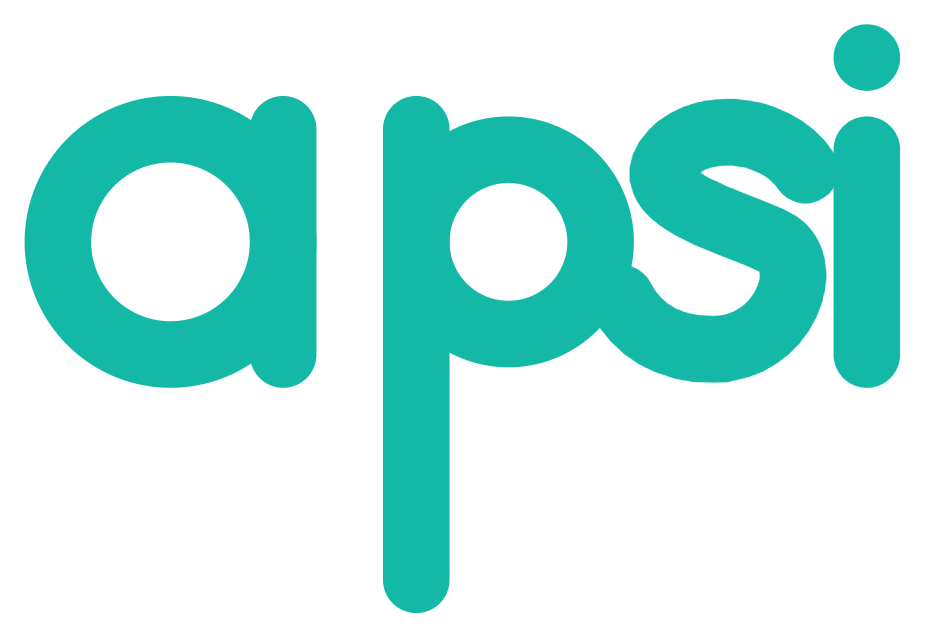

<p align="center"></p>

<p align="center"><strong>A programming language for AI, physics and servers — that reads like Python and checks your work before it runs.</strong></p>

<p align="center">
  <a href="https://github.com/ATECTechnologies/apsi/actions/workflows/linux-x64.yml"></a>
  <a href="https://github.com/ATECTechnologies/apsi/actions/workflows/darwin-x64.yml"></a>
  <a href="https://github.com/ATECTechnologies/apsi/actions/workflows/windows-x64.yml"></a>
</p>
<p align="center">
  <a href="https://github.com/ATECTechnologies/apsi/actions/workflows/linux-arm64.yml"></a>
  <a href="https://github.com/ATECTechnologies/apsi/actions/workflows/darwin-arm64.yml"></a>
</p>
<p align="center">
  <a href="https://apsi.dev/download"></a>
  
  
  
  <a href="LICENSE"></a>
</p>

<p align="center">
  <a href="https://apsi.dev">Website</a> ·
  <a href="https://apsi.dev/docs">Documentation</a> ·
  <a href="docs/WHATS-NEW.md">What's new in 2.4.4</a> ·
  <a href="https://apsi.dev/benchmarks">Benchmarks</a> ·
  <a href="https://apsi.dev/download">Download</a>
</p>

---

## What is Apsi?

Apsi is a programming language with the syntax of Python and the safety net of a compiler. Physical units, tensor
shapes and types are checked before the program starts, so `5m + 2s` or a matrix of the wrong size is an error on the
line where you wrote it, not a wrong number an hour later. Numeric code compiles to machine code, and every Python
library is one `pyimport` away.

```apsi
use physics.constants

fn kinetic(m: Mass, v: Velocity) -> Energy = 0.5 * m * v ** 2

print(kinetic(2kg, 3[m/s]))            # 9.0 J
print(m_e * c ** 2 as [MeV])           # 0.510998949996 MeV
let wrong = 5m + 2s                    # ✗ UnitError before running: cannot add Length and Time

@native                                # machine code for this CPU, units checked then erased
fn energy(x, v, k: Float) -> Float:
    var e = 0.0
    parallel for i in 0..len(x):       # all CPU cores; @gpu runs the same loop on NVIDIA GPUs
        e += 0.5 * v[i] * v[i] + 0.5 * k * x[i] * x[i]
    return e
```

## How Apsi is different

| | Python | Apsi |
|---|---|---|
| Units (`9.81[m/s^2]`, `5km`) | a library, checked at run time | part of the language, checked before running |
| Tensor shapes | found when the program crashes | `fn f[B, T](x: Tensor[B, T])` names the wrong dimension before running |
| Speed of numeric loops | interpreter | `@native`: LLVM machine code, next to C and Rust on the [benchmarks](https://apsi.dev/benchmarks) |
| Existing Python code | — | `apsi convert` turns it into Apsi that behaves byte for byte the same |
| Permissions | a script can read any file and open any socket | files, network and Python modules are off until you allow them |
| Built in | — | autodiff, layers, RL, real-time loops, tables, PostgreSQL / MySQL / MongoDB / Redis, an HTTP and WebSocket server |

## Install

**Download: [apsi.dev/download](https://apsi.dev/download)** — every version, with the SHA-256 of each file.

| System | File | Install |
|---|---|---|
| Windows 10/11 (x64) | `ApsiSetup-2.4.4-x64.exe` | double-click (brings its own Python; no administrator rights) |
| Any Linux, also WSL | `ApsiSetup-2.4.4-linux.sh` | `sh ApsiSetup-2.4.4-linux.sh` (no root) |
| Ubuntu / Debian | `apsi_2.4.4_all.deb` | `sudo apt install ./apsi_2.4.4_all.deb` |

From this repository: `pip install numpy`, then `./apsi.sh run examples/01_hello.apsi` (Linux, macOS) or
`apsi.bat run examples\01_hello.apsi` (Windows). Building the installers: [`docs/BUILD.md`](docs/BUILD.md).

## Quick start

```bash
apsi new hello && cd hello
apsi run                        # runs src/main.apsi
apsi test                       # runs the tests next to it
apsi convert script.py          # an existing Python program → script.apsi, same behaviour
apsi debug app.apsi             # breakpoints and stepping (or F5 in VS Code)
```

Then read [Getting started](docs/GETTING-STARTED.md) (15 minutes) or [Write Apsi your way](docs/WRITE-APSI.md).

## What's new in 2.4.4

* **Train AI on your own NVIDIA card, faster than PyTorch, with nothing else installed.** `fit(…, backend="gpu")`
  runs Apsi's own tensor-core kernels: a 10.9 M-parameter GPT trains at **151,744 tokens/s** on an RTX 3060 against
  PyTorch 2.14's 126,993 on the same data, every epoch at the same speed, the card held at 77 °C by its power limit.
  bf16, fp8, fp6 and fp4 training; several cards with `device="cuda:all"`; `ema=` and `ewc=`; the **Apsi GPU Tuner**
  sets the best power limit for every NVIDIA card in one click ([GPU guide](docs/GPU.md)).
* **Serve what you train.** `apsi serve-model` puts a language model behind the OpenAI API (streaming, queue, metrics);
  Qwen2.5 0.5B, 3B and 14B run fully on a 12 GB card.
* **Python, exactly.** Every Python 3.13 construct converts — classes and metaclasses, `match`, `async`, `except*`,
  generics, `import *`. 34 standard-library modules (about 38,000 lines) convert and print byte-identical output.
* **Real time.** 1–2 kHz control loops and video pipelines from 640×480 to 4K with newest-frame hand-off and latency
  reports (`use rt`).
* **Memory.** Arrays that move to the SSD instead of running out of RAM, container-aware limits, memory-pressure
  reactions, reusable buffers, flat-memory streaming of files larger than RAM, OOM-safe batches, data-parallel
  training on several processes (`use memory`, `fit(workers=…)`).
* **Language models on your GPU, no install.** Hugging Face models (BERT family, GPT-2, Llama, Mistral, Qwen, Gemma)
  run natively; on NVIDIA cards only the display driver is needed. On an RTX 3060: Qwen2.5-0.5B at about 190 tokens/s,
  3B at 47 (82 % of what the card's memory allows), a 14B model split across GPU and RAM by itself; tensor cores for
  prompts, a float16 cache, int8 weights on the processor, `lm.plan` to see where everything runs (`use hub`).
* **Logs, settings, checkpoints.** `use log` and `apsi log`; `use config` (TOML/JSON/YAML/INI/.env, layered,
  overridable, checked); `save_checkpoint` with optimizer state in one file or shards; `diagnose()` for models built
  from scratch; `data.text_dataset` for training text in any shape; `apsi cache`.
* **Several versions side by side.** 2.4.4, 2.5 … each in its own folder; `apsi versions`, `apsi use 2.4.4`.
* **Every number format down to FP8.** f64, f32, f16, bf16, FP8 and int8 tensors in `@native` and `@gpu` code:
  stored small, computed in f32, rounded correctly — bit-identical to NumPy and ml_dtypes.
* **Graphs that reach far.** Graph transformers, global attention (one hop to any node), k-hop and mixed-hop layers.
* **A smarter GPU.** One thread per element, Tensor Cores through cuBLAS for f16/bf16 matrix products, and small
  launches sent to the CPU automatically.
* **None-safe code.** `config.get("port") ?? 8080`, `user?.address?.city`, `rows?[0]`; and `use collections`
  (`Counter`, `Heap`, `Deque`, `LRUCache`, `DefaultDict`, `OrderedSet`, `BiMap`) with `first`, `partition`,
  `scan`, `fold`, `flat_map`, `min_by` and more built in.
* **The same speed on every processor.** Independent outer iterations run as SIMD vectors that Apsi writes itself
  (bit-identical results), so AVX2 desktops get the same vector code as AVX-512 servers; `@native("fma")` fuses
  multiply-adds like C compilers do by default.
* **Matrix products from plain loops.** Three nested loops computing `c[i, j] += a[i, k] * b[k, j]` run on the tuned
  BLAS kernel: 11× faster than the same loops in C with `-O3` at 2048×2048.
* **Fewer AI tokens.** Exactly reversible packing of what you send to language models: 57–63 % fewer tokens for
  record lists (`use tokens`).
* **Data.** A columnar table engine, up to 21× faster than pandas (`use dataframe`); PostgreSQL, MySQL/MariaDB, MongoDB,
  Redis and SQLite clients with no driver to install (`use db`).
* **Web.** An HTTP server 2.4–2.7× faster than 2.0.0 per process (about 7.5× with `processes="auto"`), WebSocket routes and rooms, `.env` files and secrets.
* **Tools.** A debugger, a 32 % faster cold compile, and the Apsi License 2.0, which allows commercial use.
* **Speed.** 4.21× faster than 2.0.0 on the same programs; on eight CPU programs 0.83× the time of C (C++ 0.88×,
  Rust 1.07×, Julia 1.22×, Java 1.66×, Go 2.75×, C# 2.89×, JavaScript 3.56×) — [benchmarks](https://github.com/ATECTechnologies/apsi/tree/main/benchmarks).

Details, examples and measurements: [`docs/WHATS-NEW.md`](docs/WHATS-NEW.md) · every change: [`CHANGELOG.md`](CHANGELOG.md).

## Supported platforms

| | |
|---|---|
| Operating systems | Windows 10 / 11 (x64), Linux x86-64 and ARM64 (Ubuntu 22.04+, Debian 12+, Fedora, Arch, WSL), macOS on Apple silicon and Intel — each tested on every push |
| Python (host runtime) | 3.12, 3.13, 3.14 |
| Native compiler | x86-64 with AVX2 / AVX-512, ARM64 with NEON (needs `llvmlite`; on Intel Macs, where llvmlite has no wheels, Apsi runs without it) |
| GPUs | NVIDIA GTX 1660 and newer for `@gpu` (Tensor Cores through cuBLAS); AMD ROCm, Apple MPS, Intel XPU through the PyTorch backend |
| Editors | VS Code, Cursor, Windsurf, VSCodium, Sublime Text, Vim/Neovim, Notepad++, JetBrains, Helix, Zed, Emacs |

## Documentation

| Start | Language | Topics |
|---|---|---|
| [Getting started](docs/GETTING-STARTED.md) | [Language reference](docs/LANGUAGE.md) | [AI](docs/AI.md) · [Layers](docs/LAYERS.md) · [RL](docs/RL.md) |
| [What's new](docs/WHATS-NEW.md) | [Everything on one page](docs/REFERENCE.md) | [From Python](docs/PYTHON.md) · [Native code](docs/NATIVE.md) |
| [Install](docs/INSTALL.md) · [Linux](docs/INSTALL-LINUX.md) | [Project overview](docs/OVERVIEW.md) | [Real time](docs/REALTIME.md) · [Memory](docs/MEMORY.md) · [Tokens](docs/TOKENS.md) · [Hub](docs/HUB.md) · [Graphs](docs/GRAPHS.md) · [Number formats](docs/NUMBERS.md) |
| [Troubleshooting](docs/TROUBLESHOOTING.md) | [Security](docs/SECURITY.md) | [Tables](docs/DATAFRAME.md) · [Databases](docs/DATABASES.md) · [Servers](docs/SERVER.md) |
| [Versions compared](docs/VERSIONS.md) | [Editors](docs/EDITORS.md) | [Science](docs/SCIENCE.md) · [Debugging](docs/DEBUGGING.md) · [Configuration](docs/ENV.md) |

The same documentation, searchable, is at [apsi.dev/docs](https://apsi.dev/docs).

## Repository layout

```
apsi/          the language: lexer, parser, checker, compiler, runtime, standard library, tools
apsi/native/   the native compiler (LLVM) and GPU code generation
docs/          documentation (also published on apsi.dev)
examples/      runnable examples, also used as tests
tests/         the test suite (python -m unittest discover tests; apsi test tests/apsi examples)
benchmarks/    benchmark programs in Apsi, C, C++, Rust, Go, Java, JavaScript, C#, Julia, Mojo, plus pandas, Node.js and Python comparisons
editors/       editor extensions (VS Code family, Sublime Text, Vim, Notepad++ …)
installer/     the Windows setup wizard;  packaging/  wheel, .deb and Linux installer builders
playground/    the WebAssembly playground
```

## Contributing

Bug reports and pull requests are welcome. Before sending a pull request, run the tests:

```bash
python -m unittest discover tests
apsi test tests/apsi examples
apsi fmt --check examples tests/apsi
```

Security problems: please report them privately as described in [`docs/SECURITY.md`](docs/SECURITY.md) or at
[apsi.dev/security](https://apsi.dev/security), not in public issues.

## How Apsi was built

Apsi is the work of one developer at ATEC, working together with Claude, the AI model made by Anthropic. Development
started on 8 November 2026; everything from the first version to 2.4.4 — the language, checker and compilers, native
and GPU code generation, the Python converter, the standard library, the tools, the documentation and the website —
took about **25 hours of active work** in total (time actually spent working, in sessions over several days).
This figure is final: it covers the first build of the project, from nothing to a finished 2.4.4. Apsi 2.4.4 is
complete as that first stage; later versions are new work and are not added to it.

## License

Apsi is developed by **ATEC** and published under the [Apsi License 2.0](LICENSE). In short: use it for anything,
including commercial work; the programs, libraries and models you build with it are yours; Apsi itself may not be
sold or offered as a paid service without a licence from ATEC; copies and changed versions of Apsi credit ATEC and
stay under the same licence. Plain-language guide with examples: [`docs/LICENSING.md`](docs/LICENSING.md).
